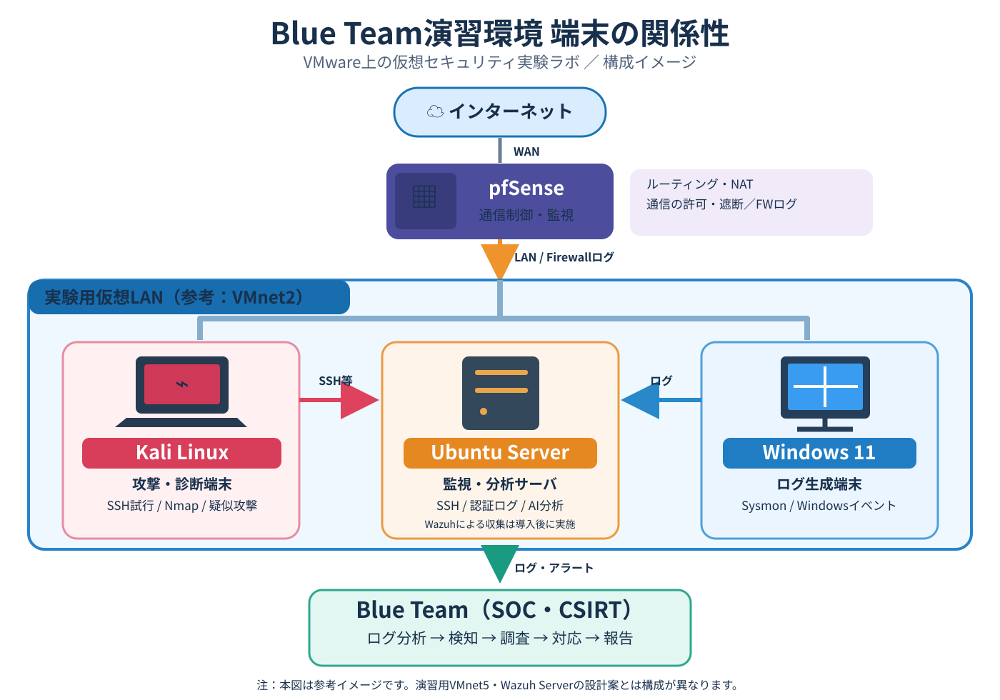
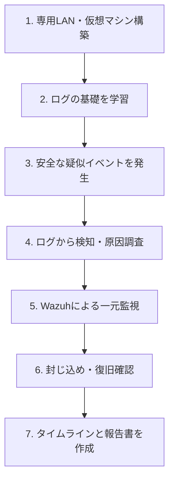

# Blue Team / SOC・CSIRT Security Lab

> サイバー攻撃の兆候をログと通信から検知し、調査・封じ込め・復旧・報告までを実践する自主学習用のブルーチーム演習環境。

**進捗：環境設計段階（仮想マシン・監視基盤の構築、各演習はこれから実施）**

このプロジェクトは、生成AIを使ったセキュリティ研究とは**別の独立した演習**として進めます。すべて自分で管理する仮想ネットワーク内で、安全な疑似操作・模擬イベントを扱います。

## 1. 目的

**SOC・CSIRTの基礎である「検知 → 調査 → 判断 → 封じ込め → 復旧 → 報告」を、証拠に基づいて実践すること**を目標とします。

- **検知：** 認証ログ、通信ログ、Windowsイベントログから不審な事象を見つける。
- **調査：** 発生時刻、送信元・宛先、実行された操作、影響範囲を特定する。
- **判断：** 正常な操作、誤検知、対応が必要な事象を区別する。
- **対応：** 状況に応じて通信の遮断や原因の除去を行い、復旧を確認する。
- **報告：** タイムライン、証拠、調査結果、対策、再発防止策を記録する。

攻撃を再現して終わるのではなく、**ブルーチームの視点からログを読み、根拠を示して対処する**ことを重視します。

## 2. 必要なもの

### ホスト環境

- メモリ **64GB** のPC
- **VMware Workstation**
- 仮想ディスクを保存できる十分な空き容量
- ソフトウェア導入時だけ利用する一時的なインターネット接続（必要に応じて）

### 仮想マシン（予定）

| マシン | vCPU（目安） | メモリ | 役割 |
|---|---:|---:|---|
| Kali Linux | 2 | 4GB | 自分の演習環境内で疑似攻撃・不審通信を発生させる |
| Ubuntu Server | 2 | 4GB | Linuxの監視対象。SSH、認証ログ、通信ログを扱う |
| Windows 11 | 2〜4 | 8GB | Windowsイベントログ・Sysmonによる端末調査 |
| Wazuh Server（Ubuntu） | 4 | 8GB | Wazuh Manager / Indexer / Dashboardによるログ収集・検知・分析 |
| **合計** | **10〜12** | **24GB** | **演習用の4台構成** |

※CPU割り当てはホストPCの物理コア数や同時起動数に合わせて調整します。Wazuh Serverには80〜100GB程度の仮想ディスクを目安として確保します（ログ量・保持期間に応じて変更）。

### 使用ツール

| ツール | 用途 |
|---|---|
| Wireshark / tcpdump | パケット取得・通信解析 |
| OpenSSH / journalctl | SSH接続・Linux認証ログ調査 |
| Nmap | 隔離環境内でポートスキャンを模擬 |
| Windows Event Viewer | Windowsイベントログ調査 |
| Sysmon | Windowsのプロセス実行などの詳細なログ取得 |
| Wazuh（Server / Agent） | ログの一元監視、検知ルール、アラートの分析 |
| Markdown / VS Code | 調査記録とインシデント報告書の作成 |

## 3. 端末の関係性（参考イメージ）



Kali Linuxで演習用のSSH試行や通信を発生させ、Ubuntu ServerやWindows 11に記録されたログを確認し、Blue Teamとして検知・調査・対応を行う流れを示した概念図です。pfSenseは異なるネットワーク間の通信制御・監視に使用します。

**注意：** この画像は説明用の参考図であり、以下の独立したVMnet5・Wazuh Server構成の設計案と同一ではありません。実際の経路や導入済みの監視ツールを示す確定図ではありません。

## 3. ネットワーク構成（設計案）

VMwareの**Host-onlyネットワーク（VMnet5）**で演習対象を接続します。

```text
               VMware Workstation
          VMnet5: 192.168.50.0/24
              （Host-only LAN）
                       │
         ┌─────────────┼─────────────┐
         │             │             │
   Kali Linux     Ubuntu Server   Windows 11
  192.168.50.40   192.168.50.20   192.168.50.30
    疑似攻撃        Linuxログ        Sysmonログ
                       │             │
                       └──────┬──────┘
                              │  Wazuh Agent
                        Wazuh Server
                        192.168.50.10
                     Manager/Indexer/Dashboard
```

| 仮想マシン | IPアドレス（予定） |
|---|---|
| Wazuh Server | `192.168.50.10` |
| Ubuntu Server | `192.168.50.20` |
| Windows 11 | `192.168.50.30` |
| Kali Linux | `192.168.50.40` |

**注意：** 上記IPアドレスは設計値であり、割り当て済みを意味しません。VMnet5のサブネットを`192.168.50.0/24`に設定し、DHCPを使わない場合は各VMに静的IPを設定します。演習ネットワークは通常インターネットから隔離し、インストール時だけ必要に応じて一時的にNATを利用します。前の研究環境のネットワークとは混在させません。

## 4. ワークフロー



| STEP | 実施内容 | 確認・記録するもの | 状態 |
|---|---|---|---|
| 1. 環境構築 | VMnet5、4台のVM、IP設定、疎通確認 | ネットワーク構成図、疎通結果 | 未着手・設定確認待ち |
| 2. ログの基礎 | Linux認証ログ、Windowsイベントログ、通信ログの読み方 | 時刻・IP・操作の記録例 | 未着手 |
| 3. 疑似イベント | SSHログイン失敗、ポートスキャン、不審なプロセスの模擬 | 各操作の開始時刻・条件 | 未着手 |
| 4. 検知・調査 | 発生したイベントをログから特定・分類 | 攻撃元、対象、操作内容、判断根拠 | 未着手 |
| 5. 一元監視 | Wazuh Agent導入、ルール・アラート確認 | Wazuhの検知結果と元ログ | 未着手 |
| 6. 対応 | 必要な通信の遮断、原因除去、復旧確認 | 対策前後の比較 | 未着手 |
| 7. 報告 | 経過、影響、証拠、実施した対応を整理 | インシデント報告書 | 未着手 |

## 5. 実施するブルーチーム演習

基礎から応用へ、以下の順に取り組みます。

| 回 | 演習 | 主に学ぶ技術 |
|---|---|---|
| 01 | **SSHログイン失敗の検知** | `journalctl`、認証ログ、不審なログイン試行 |
| 02 | **ポートスキャンの検知** | Nmap、tcpdump / Wireshark、TCP/IP |
| 03 | **Windowsの不審プロセス調査** | Sysmon、イベントID、プロセス親子関係 |
| 04 | **フィッシングメールの分析** | メールヘッダー、URL分析、証拠の保全 |
| 05 | **WazuhによるSOCアラート分析** | Wazuh Agent、検知ルール、トリアージ |
| 06 | **マルウェア感染を想定した初動調査** | 安全な模擬ログ、影響範囲の調査 |
| 07 | **ランサムウェア対応の机上・模擬演習** | 隔離判断、バックアップ、復旧手順 |
| 08 | **CSIRT総合演習** | 検知→分析→封じ込め→復旧→報告 |

※実際のマルウェアやランサムウェアを実行する必要はありません。安全な模擬イベントとログで対応手順を学びます。

## 6. 演習の進め方

各演習は次の順序で行い、**「起きた事実」と「調査担当者の推測」を分けて記録**します。

1. シナリオと正常な状態を確認する。
2. 演習用イベントを発生させ、時刻を控える。
3. 元ログを保存し、送信元・宛先・操作・成否を調べる。
4. 事象を分類し、追加調査が必要か判断する。
5. 安全な対策を実施し、再度試験して効果を確かめる。
6. インシデント報告書に、根拠・対応・残る課題をまとめる。

## 7. 最終的な成果物

- 演習専用ネットワークの構成図
- 設定・導入手順と各VMの役割
- 模擬イベントの実行条件・ログ
- Wazuhのアラートと元ログの比較
- 調査タイムライン（いつ・誰が・何をしたか）
- 封じ込め・復旧の検証記録
- インシデント報告書（原因・影響・対応・再発防止策）

## 8. 次に行うこと

**STEP 1：VMnet5の設定状態を確認し、Wazuh Server用のUbuntu仮想マシンを新規作成する。**

1. VMware Workstationの仮想ネットワークエディタで、`VMnet5` がHost-only・`192.168.50.0/24`であることを確認する。
2. Wazuh Server用にUbuntu Serverの仮想マシンを新規作成する。
3. 4台のVMに演習用LANのアダプターを接続し、IPアドレスと疎通を確認する。
4. Linuxの認証ログから、演習01を始める。

---

**安全上のルール：** スキャンや疑似攻撃は、自分が管理する隔離された演習環境のみに限定します。調査記録・スクリーンショットを公開する前に、認証情報などが含まれていないか確認します。
